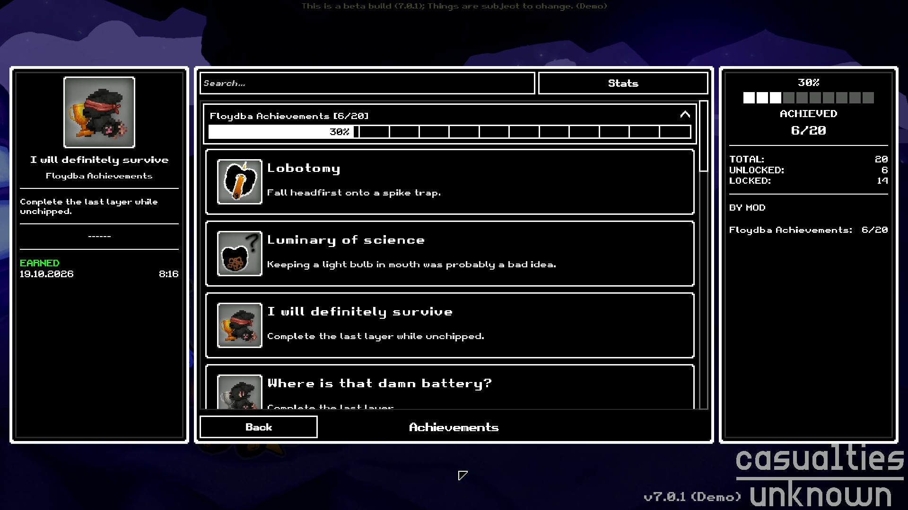
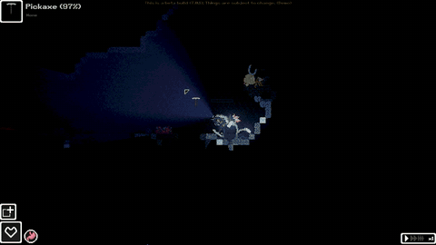
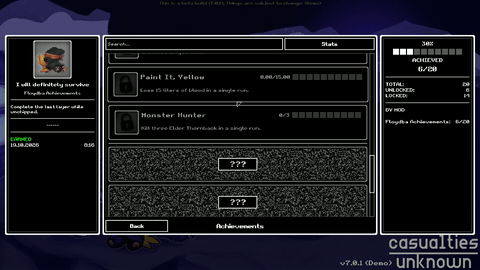
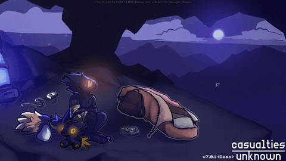
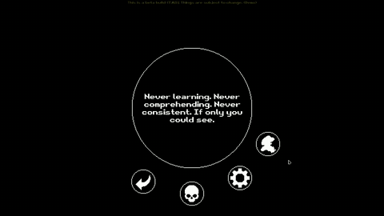

# CUAchievements

An achievement framework for **Casualties: Unknown**. Mods use it to add their own achievements, and players get one shared menu, pop-up notifications and statistics for all of them.

[Nexus Mods](https://www.nexusmods.com/scavprototype/mods/801) · [Releases](https://github.com/J1ND3R9/CUAchievements/releases) · [Discord](https://discord.gg/AJDjmyeEFe) · [Example mod](https://github.com/J1ND3R9/FloydbaAchievements)



## Features

- Pop-up notifications with four display styles and an unlock sound.
- A shared menu with search, statistics and a details panel, available from the main menu and the pause menu.
- Achievements grouped by mod, each group with its own progress bar.
- Instant achievements and counter achievements with progress.
- Lifetime and single-run achievements. Run progress is stored in the game save, so it survives saving and exiting.
- Hidden achievements that the player can reveal, or that are shown as a single counter card.
- Three difficulty levels, each with its own frame.
- Anti-cheat that blocks achievements for the rest of the run after an unsafe console command.

<table>
  <tr>
    <td align="center"><br>Pop-up notification</td>
    <td align="center"><br>Revealable hidden achievements</td>
  </tr>
  <tr>
    <td align="center"><br>Main menu button</td>
    <td align="center"><br>Pause menu</td>
  </tr>
</table>

## For players

### Installation

1. Install [BepInEx](https://github.com/bepinex/bepinex).
2. Install [CUCoreLib](https://www.nexusmods.com/scavprototype/mods/341).
3. Download CUAchievements from [Nexus Mods](https://www.nexusmods.com/scavprototype/mods/801) or [Releases](https://github.com/J1ND3R9/CUAchievements/releases).
4. Place the `CUAchievements` folder into `BepInEx/plugins`.
5. Launch the game. A greeting pop-up confirms that the mod is working.

CUAchievements adds no achievements by itself. Install a mod that does, such as [Floydba Achievements](https://github.com/J1ND3R9/FloydbaAchievements).

### Settings

Most settings are in the in-game mod options, in the Achievements section. All of them are also in `BepInEx/config/com.cuachievements.cfg`.

| Setting | Default | Description |
| --- | --- | --- |
| Alert type | Pop-up | Pop-up, the standard in-game alert, or no notification. |
| Display type | Bottom to top | Pop-up animation: bottom to top, left to right, top to bottom, or Steam-like. |
| Pop-up duration | 5 s | From 1 to 15 seconds. |
| Unlock volume | 100% | Volume of the unlock sound. |
| Percentage for the pop-up | 25% | Show a progress pop-up at every N percent. 0 turns it off. |
| Greetings message | On | The pop-up shown when the game starts. |
| Revealable hidden achievements | On | Show each hidden achievement as a card revealed by clicking. When off, all of them share a single counter card. |
| Scope in achievement list | Off | Show the scope of each achievement in the list. |
| Easter eggs | On | Purely visual, gameplay is not affected. |
| `AnticheatEnabled` | On | Config file only. See [Anti-cheat](#anti-cheat). |
| `AllowSandboxAchievements` | Off | Config file only. Allow all achievements in the tutorial and sandbox. |
| `Verbose` | Off | Config file only. Write detailed logs. |

### Anti-cheat

An unknown or unsafe console command marks the current run as cheated. Achievements then cannot be unlocked or gain progress until the run ends. The mark is stored in the game save, so saving and exiting does not remove it.

### Something doesn't work?

Check `BepInEx/LogOutput.log` for errors, then ask on [Discord](https://discord.gg/AJDjmyeEFe) or [open an issue](https://github.com/J1ND3R9/CUAchievements/issues) and attach the log. Don't hesitate to ask even the "dumbest" questions. :)

## For developers

### Setup

Add references to `CUAchievements.dll` and `CUCoreLib.dll`, then declare CUAchievements as a dependency so that BepInEx loads it first:

```csharp
using BepInEx;
using CUAchievements;
using CUCoreLib.Helpers;

[BepInPlugin(ModGuid, ModName, ModVersion)]
[BepInDependency("com.cuachievements", BepInDependency.DependencyFlags.HardDependency)]
public class Plugin : BaseUnityPlugin
{
    public const string ModGuid = "com.example.myachievements";
    public const string ModName = "My Achievements";
    public const string ModVersion = "1.0.0";

    internal static AchievementsAPI Achievements;

    private void Awake()
    {
        Achievements = AchievementsAPI.Create(ModGuid);

        // Instant: earned with a single call.
        Achievements.Register(AchievementDefinition.Instant(
            id: "luminary_of_science",
            name: "Luminary of science",
            description: "Keeping a light bulb in mouth was probably a bad idea.",
            icon: AssetLoader.LoadEmbeddedSprite("Assets.Images.luminary.png"),
            hidden: true));

        // Counter: unlocks when the progress reaches maxProgress.
        Achievements.Register(AchievementDefinition.Counter(
            id: "paint_it_yellow",
            name: "Paint It, Yellow",
            description: "Lose 15 liters of blood in a single run.",
            maxProgress: 15f,
            icon: null, // null = default icon, a warning is logged
            scope: AchievementScope.Run,
            progressDecimals: 2));
    }
}
```

Then call the API from your gameplay code, for example from a Harmony patch:

```csharp
Plugin.Achievements.Unlock("luminary_of_science");
Plugin.Achievements.AddProgress("paint_it_yellow", liters);
```

IDs only need to be unique within your mod: they are stored as `<GUID>::<id>`, so different mods can't conflict.

> [!IMPORTANT]
> Do not change your plugin GUID or achievement IDs after release. Saved progress is keyed by them, so players would lose it.

### Options

`Instant` and `Counter` accept these optional parameters:

| Parameter | Default | Description |
| --- | --- | --- |
| `shortDescription` | `description` | Shorter text for the achievements list. The full description is shown in the details panel. |
| `difficulty` | `Normal` | `Normal`, `Difficult` or `Hard`. Selects the frame and affects the order in the menu. |
| `scope` | `Lifetime` | See [Scope](#scope). |
| `hidden` | `false` | Hides the achievement details until it is unlocked or revealed. |
| `lockedIcon` | Default icon | Icon shown while the achievement is locked. |
| `customFrame` | `null` | Replaces the frame selected by `difficulty`. |
| `canGetInTutorial` | `false` | Whether the achievement can be earned in the tutorial or sandbox. |
| `progressDecimals` | `0` | `Counter` only. Digits after the decimal point in the displayed progress. |

> [!NOTE]
> With the default `canGetInTutorial: false`, an achievement can't be earned in the tutorial or sandbox. Keep this in mind when testing, or set `AllowSandboxAchievements` in the config.

### Scope

- `AchievementScope.Lifetime`: progress and condition flags are kept between runs and game restarts.
- `AchievementScope.Run`: the achievement must be earned within a single run. Progress and condition flags are stored in the game save and are cleared when the character dies or a new run starts.

### Conditions

Every achievement has a `ConditionalTracker`, a set of named flags for achievements that depend on several conditions:

```csharp
// Achievement with AchievementScope.Run: finish a run without using painkillers.
var tracker = achievement.ConditionalTracker;

void OnPainkillersUsed() => tracker.SetFlag("used_painkillers", true);

void OnRunFinished()
{
    if (!tracker.GetFlag("used_painkillers"))
        achievement.Unlock();
}
```

Here `achievement` is the value returned by `Register`, or one you get from `TryGet`.

Flags are saved automatically and follow the scope. With `Run` they are stored with the run and cleared together with it. With `Lifetime` they stay set until your mod clears them, so a condition like the one above needs `Run`, otherwise a single use would block the achievement forever.

`Lifetime` flags can't be set in a cheated run, or in the tutorial and sandbox if the achievement can't be earned there.

### Localization

To translate an achievement, pass `LocalizedText` instead of a plain string:

```csharp
name: new LocalizedText("achievement_paint_it_yellow_name", "Paint It, Yellow"),
```

Don't use `LocaleRegistry.Get()` here. Achievements are usually registered in `Awake`, before the language is loaded, so the fallback text would stay in the definition forever. `LocalizedText` looks the text up each time it is displayed.

### Icons

Use a square PNG, 256x256 is recommended and 152x152 is the minimum. For smooth artwork, switch the filter to bilinear. For pixel art, use `FilterMode.Point`:

```csharp
icon.texture.filterMode = FilterMode.Bilinear;
```

### Good to know

- Register achievements in `Awake`, so that the list doesn't change while the player is using the menu.
- The API works on the Unity main thread only.
- `AchievementEvents.AchievementsChanged` is raised after any progress change or unlock.
- The XML documentation ships with the mod as `CUAchievements.xml`, so your IDE shows it next to the API.

[Floydba Achievements](https://github.com/J1ND3R9/FloydbaAchievements) uses almost everything CUAchievements has to offer, so it's a good place to see real examples.

## Roadmap

- [ ] Full documentation
- [ ] Multiplayer support
- [ ] Custom achievement unlock sounds
- [ ] Sorting settings

## Contributing

Any contribution is welcome! Please follow the existing code style, and prefer extending existing components to adding new ones.

Submit all pull requests to the `dev` branch.

## License

[MIT](LICENSE.txt)
